<p align="center">
  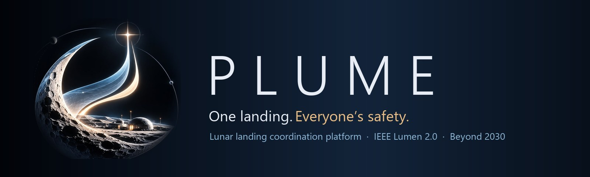
</p>

<p align="center">
  <b>A coordination platform for a crowded Moon</b><br>
  IEEE Lumen 2.0 hackathon · <b>Beyond 2030</b> challenge · Pitch session, 25 October 2026
</p>

<p align="center">
  Built by <b>Eya Azzabi</b>, <b>Sarah Faleh</b> and <b>[other team members]</b><br>
  IEEE CS ISTIC SB × IEEE CS SESAME SB
</p>

<p align="center">
  
  
  
  
  
  
  
  
</p>

<p align="center">
  <a href="#the-problem">Problem</a> ·
  <a href="#the-solution">Solution</a> ·
  <a href="#what-makes-plume-different">Why PLUME</a> ·
  <a href="#preview">Preview</a> ·
  <a href="#the-ai-copilot">AI copilot</a> ·
  <a href="#security-and-access">Security</a> ·
  <a href="#results">Results</a> ·
  <a href="#architecture">Architecture</a> ·
  <a href="#run-plume-locally">Run it</a> ·
  <a href="#team">Team</a> ·
  <a href="#limits">Limits</a>
</p>

---

## The problem

By the 2030s, several space agencies and companies plan to build at the **same small area of the Moon**: the sunlit ridges near the water ice of the lunar south pole.

Every landing digs regolith out with its engine. **On the Moon there is no air to slow that debris down**, so dust, sand and gravel fly on ballistic arcs for kilometres. One operator's touchdown can sandblast another operator's solar farm, telescope or habitat, and today there is no shared tool to predict it or to coordinate.

| Evidence | Fact |
|---|---|
| Apollo 12 (1969) | Landed about **160 m** from the Surveyor 3 probe; parts brought back to Earth were **sandblasted** by the descent plume |
| Chandrayaan-3 (2023) | Displaced about **2 tonnes** of regolith on touchdown (ISRO) |
| Artemis Accords, Section 11 | Signatories commit to avoid **harmful interference** and to consult |
| PLUME ejecta model | Fastest dust up to about **1.7 km/s**; sand and dust reach **kilometres** |

> In our 2040 scenario, cargo lands routinely next to permanent bases. Without coordination, the first serious incident will be between two operators who never talked to each other.

## The solution

PLUME predicts the debris each landing throws, prices the damage to **every neighbour's** registered equipment, finds a safer touchdown point, and gets the affected operators to **agree before the engines fire**.

| Step | What the user does | What PLUME does |
|---|---|---|
| **01 · Prepare** | Choose the lander (thrust, hover time, landing dispersion) and the touchdown point on a 3D south-pole map | Checks terrain, slope and clearances |
| **02 · Analyze** | Read the verdict, inspect the most exposed asset, compare alternatives | Computes damage in euros for every registered asset of other operators, screens about **1,800** nearby sites, previews before/after |
| **03 · Coordinate** | File the proposal, then revise if a neighbour objects | Notifies every affected operator automatically; they **acknowledge** or **object** with structured constraints; every revision and response is kept |

| Who | What PLUME gives them |
|---|---|
| **Landing operators** | Impact of a landing on others, safer alternatives, a filed and traceable proposal |
| **Asset owners** | A shared registry of their bases, arrays and rovers; a notice whenever someone's landing puts them at risk; a voice in the decision |
| **Agencies and insurers** | A decision record: who was warned, when, what was objected and agreed, exportable as a PDF/JSON dossier |

> **Physics computes. AI explains. People decide.** No safety number in PLUME comes from a language model.

## What makes PLUME different

| | |
|---|---|
| 🌒 **Real ejecta physics** | Four grain classes (dust → rocks) with log-normal speeds on ballistic arcs under lunar gravity, no atmosphere; an exact integral over grain speed instead of millions of particles (about 0.1 ms per landing–asset pair) |
| ⛰️ **Terrain shielding** | Every trajectory is tested against the terrain profile: ridges and crater rims protect what sits behind them |
| 💶 **Damage in euros** | Erosion, gravel impact and dust coating per asset type, averaged over 48 possible touchdown points (landing dispersion), times the registered value |
| 🧭 **Site optimizer** | Screens ~1,800 candidates (slope, clearance, structured constraints), re-scores the best with dispersion, and balances neighbour damage against surface-logistics cost |
| 🤝 **A real coordination lifecycle** | Proposals, automatic consultations, structured objections, revisions, re-consultation, immutable history and PDF/JSON decision dossiers |
| 🤖 **A guarded AI copilot** | Briefings and answers grounded in the engine's output, checked for every number, asset and risk level, with one corrective retry and an offline fallback |
| 🏢 **Multi-organization SaaS** | Accounts, organizations, invite codes, roles, a shared registry, per-organization notices and AI quota |
| 🛰️ **A guided 3D experience** | Three-step journey, plume heat map on a 3D Moon, before/after previews, onboarding checklist, notification centre, keyboard shortcuts |

---

## Preview

### 1. Arrive, sign in or create your organization

| Gateway | Sign in · create an organization · join with an invite code |
|---|---|
| 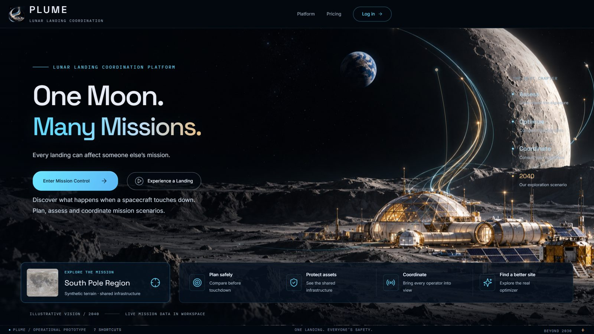 | 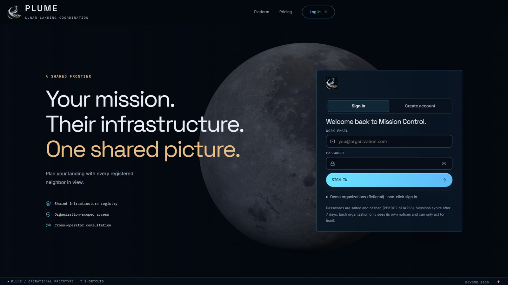 |

### 2. Prepare and analyze a landing

| Prepare: lander and touchdown point | Analyze: €14.5M of modeled damage, the telescope is critical |
|---|---|
| 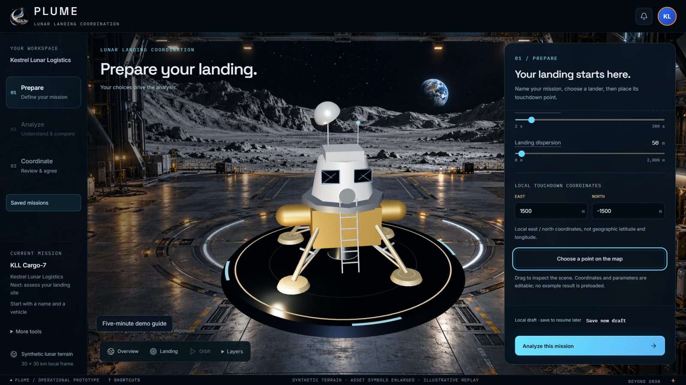 | 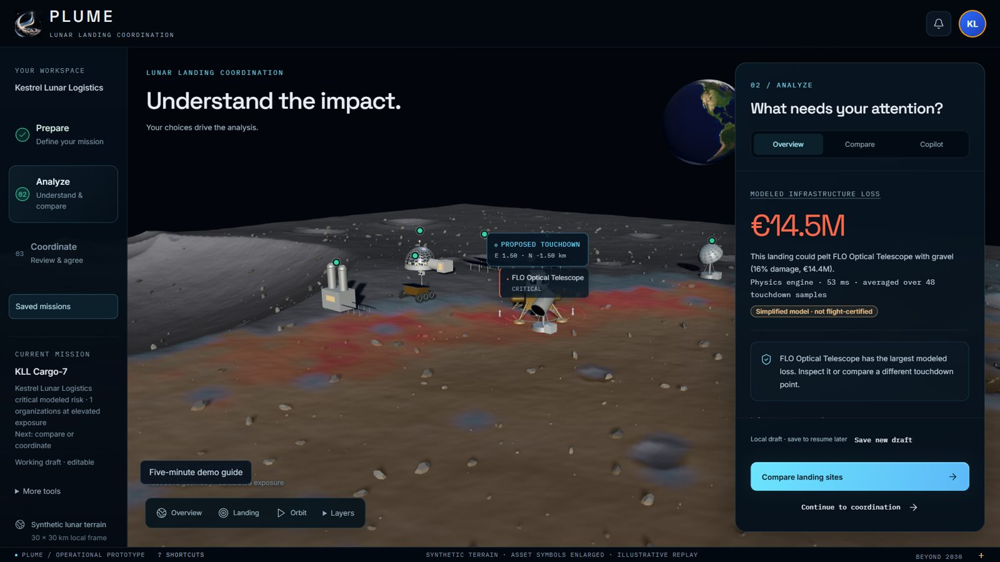 |

### 3. Compare sites and ask the copilot

| Compare: moving 2.1 km cuts modeled damage by 84% | AI briefing as cards, labelled with its source |
|---|---|
| 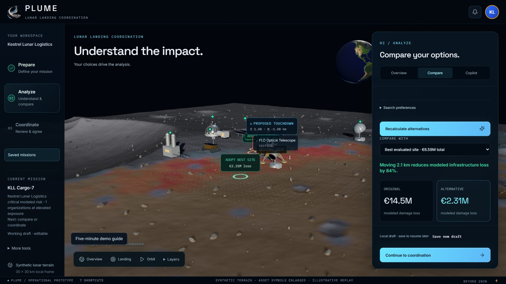 | 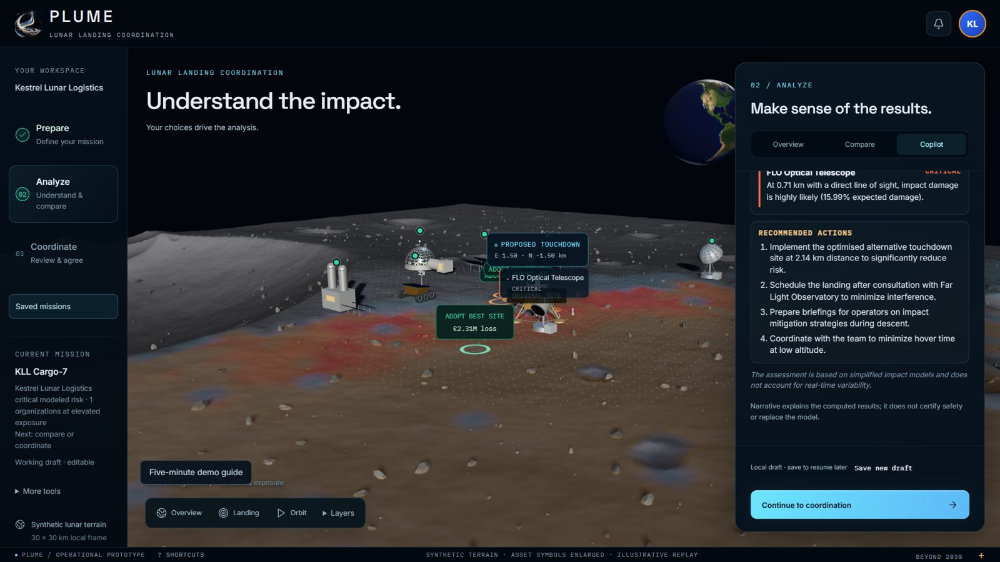 |

### 4. Coordinate with the neighbours

| The operator files the proposal | The neighbour is notified |
|---|---|
| 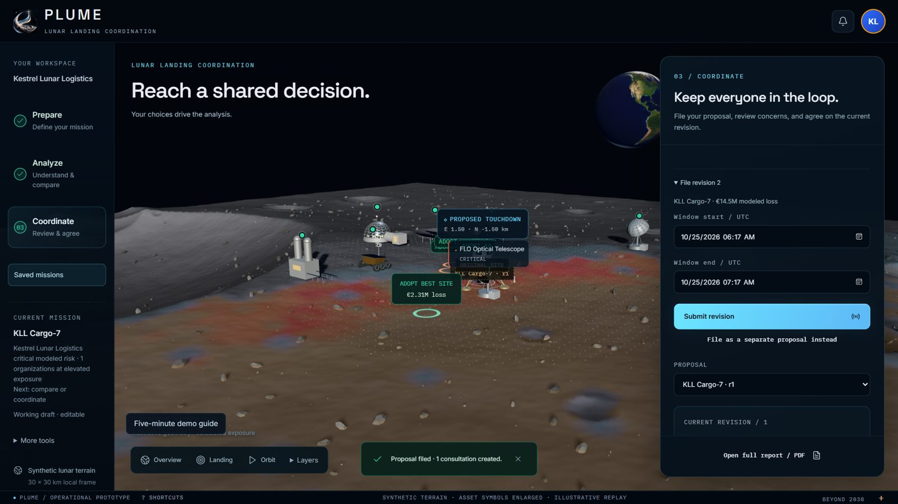 | 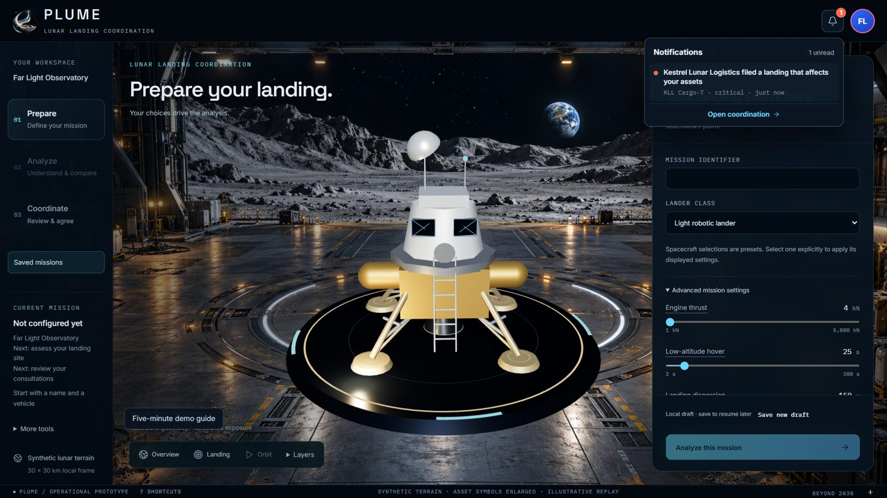 |

<details>
<summary><b>More screens</b> (consultation seen by the recipient, shared registry)</summary>

| Consultation awaiting the recipient's response | Shared lunar registry |
|---|---|
| 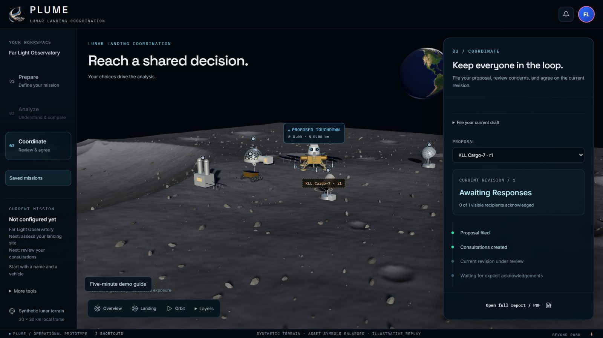 | 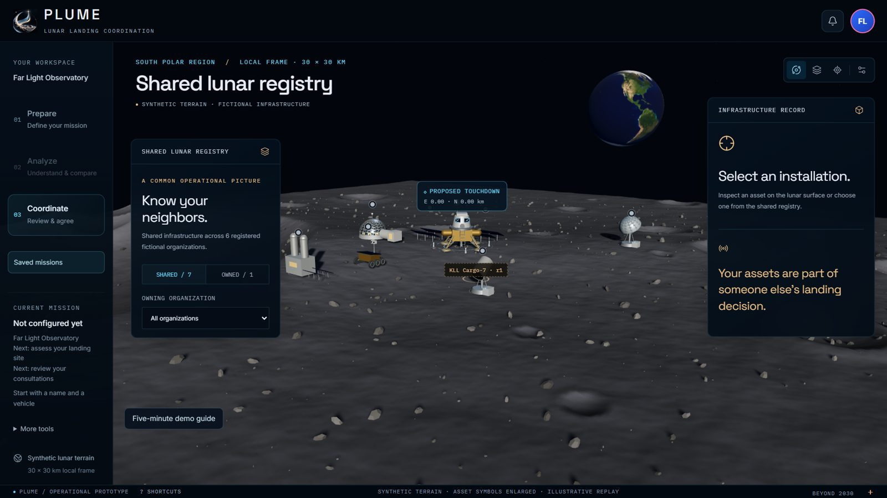 |

</details>

---

## The AI copilot

The copilot turns the physics results into a briefing for the flight director and answers questions such as *"Why is FLO Optical Telescope affected?"* or *"How much do we save by moving?"*.

| Technique | How PLUME uses it |
|---|---|
| **Grounding** | The model only receives the engine's structured output (lander, site, per-asset distance, risk, damage, mechanism, shielding, optimized alternative with pre-computed savings) |
| **Constraints** | Fixed rules, a closed list of mitigations, "never compute new numbers", damage % is expected value lost, never a probability |
| **One few-shot example** | On a fictional scenario; copying its names or numbers is rejected by the guard |
| **Structured output** | JSON `situation`, `risks[]`, `actions[]`, `limitations`, rendered as cards |
| **Verification** | Every number must exist in the data; asset names and risk levels must match the physics |
| **Corrective retry** | A rejected answer is sent back with the exact reason, once |
| **Fallback** | A deterministic template from the same data; the UI always labels the source and the reason |
| **Quota** | 20 requests/minute and 200/day per organization by default; over the limit, the template answers |

Providers: OpenAI (`OPENAI_API_KEY`) or Claude (`ANTHROPIC_API_KEY`), chosen with `PLUME_LLM_PROVIDER`. Without a key, everything works offline with the template.

## Security and access

| Guarantee | Implementation |
|---|---|
| **Passwords** | Salted PBKDF2-SHA256; never returned by the API |
| **Sessions** | HttpOnly cookies, CSRF token on every write, session epochs |
| **Organization boundaries** | Assets, plans and responses are checked against the caller's organization and permissions on the server |
| **Invitations** | Joining an organization requires its invite code; codes are only shown to its administrators |
| **Rate limits** | 10 sign-in attempts per minute; 2 concurrent heavy computations with a 20 s budget; per-organization AI quota |
| **Demo accounts** | Opt-in (`PLUME_DEMO_AUTH=true`) and loopback-only; never exposed through a proxy |
| **Fail closed** | `PLUME_ENV=production` refuses to start until a real identity provider is connected |
| **Secrets** | `backend/.env` is git-ignored; tests never load it |

### Roles

| Permission | Organization admin (creator) | Member (joined by invite) |
|---|:-:|:-:|
| Read private plans, notices and drafts | ✅ | ✅ |
| File and revise landing proposals | ✅ | ✅ |
| Register and remove the organization's assets | ✅ | ✅ |
| Acknowledge or object to consultations | ✅ | ✅ |
| See and share the invite code | ✅ | |

---

## Results

Demo scenario: super-heavy lander, touchdown at E 1.5 km / N −1.5 km, default optimizer settings.

| Indicator | Result |
|---|---|
| Modeled damage to neighbours at the requested site | **€14.5M**, FLO Optical Telescope **critical** (16% expected damage, 707 m away) |
| Best evaluated site | **€2.31M**, **−84%**, 2.1 km away |
| Candidate sites screened | **1,793** (1,424 feasible) in about 3 s |
| Single assessment, 7 assets × 48 touchdown samples | about **20–60 ms** |
| Calibration | An Apollo-class landing (15 kN, 60 s) erodes about **2 t**, the order measured for Apollo and Chandrayaan-3 |
| Historical check | Heavy sandblasting reproduced at Surveyor 3's distance (~160 m) |
| AI copilot on real OpenAI calls | **14/14** briefs and answers accepted by the guard after pre-computing savings |
| Backend tests | **59 passing** (physics, optimizer, accounts, security, coordination, drafts, copilot, quota) |
| Browser tests (current journey) | `journey`, `merged-auth`, `v4-drafts`, `v4-experience`, `v4-renderer` passing |

See [the verification log](docs/VERIFICATION.md) and [V4 delivery notes](docs/PLUME_V4_DELIVERY.md) for the exact commands and evidence.

### Reproducible example

Seed terrain 7; super-heavy 1800 kN / 30 s / 50 m; E 1500 / N −1500; radius 4 km, cost 2 M€/km, slope 8°, clearance 300 m. Baseline modeled infrastructure loss: 14.458010383 M€. Optimizer objective: 6.587186951 M€, comprising 2.312657160 M€ damage plus relocation cost. These are model outputs on fictional values, not validated real-world economic predictions.

---

## Architecture

### Current prototype

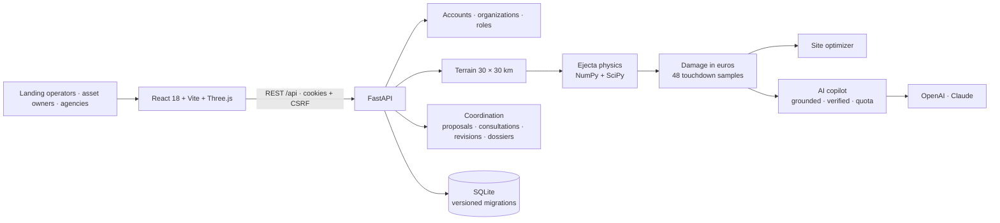

### Target production

| Component | Prototype | Production | Why |
|---|---|---|---|
| Terrain | Synthetic south-pole heightmap | **NASA LRO/LOLA** elevation models | Real slopes and shielding |
| Plume model | Calibrated ballistic model | Calibration on **CFD/DSMC** plume simulations and flight data | Accuracy across lander classes |
| Damage | Engineering sensitivities | **Lab test data** for solar cells, optics and habitats | Defensible losses |
| Identity | Accounts + invite codes, demo accounts on loopback | **Organization SSO + MFA**, agency directory | Real operators, revocation |
| Database | SQLite | **PostgreSQL**, replication, encrypted backups | Concurrency, recovery |
| AI | OpenAI or Claude through one gateway | Same gateway with self-hosted models where required | Data residency |
| Notifications | In-app | Agency and operator channels (e-mail, mission-control systems) | Nobody misses a consultation |

## Data

| Source | Use |
|---|---|
| Synthetic terrain (seed 7) | 30 × 30 km south-pole-like map with a polar crater and a sunlit ridge |
| Apollo 12 / Surveyor 3, Chandrayaan-3 | Calibration and plausibility checks of the ejecta model |
| Fictional operators and assets | Demo registry (Kestrel, Aurora, Selene, Regolith Dynamics, Polar Relay, Far Light) |

All organizations, assets and values are **fictional**.

---

## Run PLUME locally

**One command (Windows):** install the dependencies once (below), then run `./start-plume.ps1` from the repository root. It starts the backend and frontend in the background and opens http://127.0.0.1:5174/#gateway (`-NoBrowser` to skip the browser). Logs are in `backend/data/runtime/`.

**Manually** (Python 3.11+, Node 20+):

```powershell
cd backend
python -m venv .venv
.\.venv\Scripts\python.exe -m pip install -r requirements-dev.txt
$env:PLUME_DEMO_AUTH='true'
.\.venv\Scripts\python.exe -m uvicorn plume.api:app --host 127.0.0.1 --port 8001
```

```powershell
cd frontend
npm ci
$env:PLUME_API_TARGET='http://127.0.0.1:8001'
npm run dev -- --host localhost --port 5174 --strictPort
```

Open http://localhost:5174. Or build the frontend (`npm run build`) and the backend serves it on its own port.

### Demo accounts

With `PLUME_DEMO_AUTH=true`, sign in from **Log in → Demo organizations** (password `plume-demo-2040`):

| Organization | E-mail | In the demo |
|---|---|---|
| Kestrel Lunar Logistics | `kestrel@plume.demo` | Files the super-heavy cargo landing |
| Far Light Observatory | `farlight@plume.demo` | Owns the telescope at critical risk |
| Aurora Habitats · Selene Power · Regolith Dynamics · Polar Relay | `aurora@`, `selene@`, `regolith@`, `relay@plume.demo` | Other neighbours |

### Configuration

Copy [`backend/.env.example`](backend/.env.example) to `backend/.env` (never committed):

| Variable | Default | Purpose |
|---|---|---|
| `PLUME_DEMO_AUTH` | off | Enables the demo accounts (loopback only) |
| `PLUME_ENV` | `development` | `production` refuses to start without an identity provider |
| `PLUME_LLM_PROVIDER` | the key that is set | `openai` or `anthropic` |
| `OPENAI_API_KEY` / `PLUME_OPENAI_MODEL` | — / `gpt-4o-mini` | OpenAI copilot |
| `ANTHROPIC_API_KEY` / `PLUME_LLM_MODEL` | — / `claude-opus-5-5` | Claude copilot |
| `PLUME_AI_PER_MINUTE` / `PLUME_AI_PER_DAY` | 20 / 200 | AI quota per organization |
| `PLUME_CORS_ORIGINS` | local dev ports | Extra allowed origins (no wildcard) |

### Tests

```powershell
cd backend; python -m unittest discover -s tests          # 59 tests
cd frontend; npx playwright test journey.spec.ts           # against backend/serve_test.py (temporary SQLite)
```

The first start imports any older `state.json` into SQLite after validating a temporary copy and backing up the source; IDs and history are preserved.

## Documentation

- [V2 engineering guide](docs/PLUME_V2.md): architecture, API inventory, data model, migrations, identity, state machine, assumptions, benchmarks
- [V4 delivery](docs/PLUME_V4_DELIVERY.md) and [implementation log](docs/PLUME_V4.md): constraints, drafts, dossiers, guided experience
- [Frontend guide](docs/FRONTEND.md) and [guided UX](docs/GUIDED_UX.md)
- [Account merge notes](docs/AUTH_MERGE.md)
- [Verification log](docs/VERIFICATION.md)
- [Challenge specification](docs/LUMEN%202.0%20Specification%20Book.pdf)

## Team

Built for the **IEEE Lumen 2.0 hackathon**, *Beyond 2030* challenge (IEEE CS ISTIC SB × IEEE CS SESAME SB).

- **Eya Azzabi** ([@EyaAzzabi](https://github.com/EyaAzzabi))
- **Sarah Faleh** ([@sarah-falehh](https://github.com/sarah-falehh))
- **[other team members]**

## Limits

- The plume model is simplified and calibrated, not a full CFD/DSMC simulation.
- Terrain is synthetic; operators, assets and values are fictional.
- Damage sensitivities are engineering estimates, to be replaced with test data.
- Lander presets are illustrative; the super-heavy preset's thrust is conservative (high).
- The AI guard checks that every number exists in the data, not that it is used with the right meaning; safety figures always come from the physics.
- Coordination is in-app only; acknowledgement is not flight certification or safety approval.

---

<p align="center">
  <br>
  <sub>PLUME · One landing. Everyone's safety.</sub><br>
  <sub>IEEE Lumen 2.0 · Beyond 2030 · October 2026</sub>
</p>
