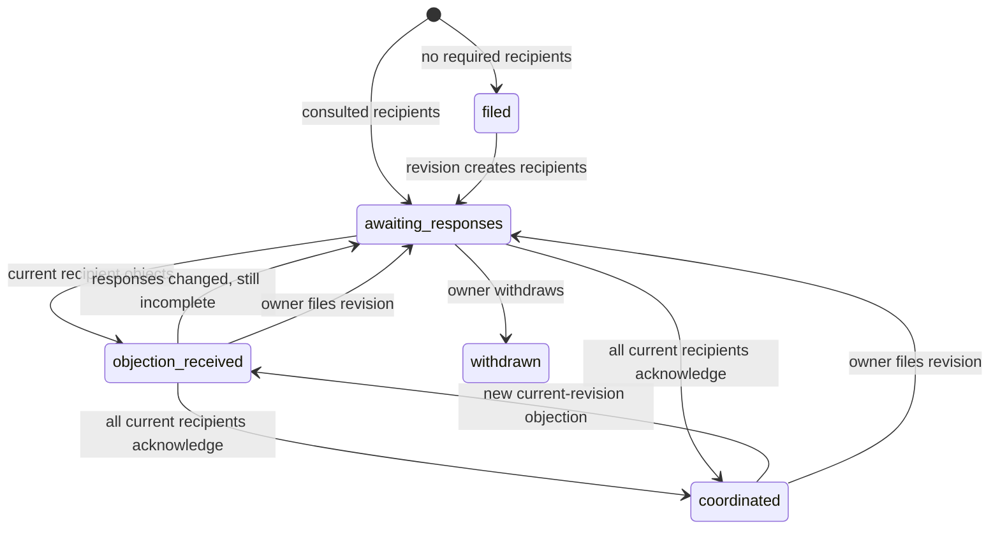

# PLUME V2 — engineering guide

PLUME remains an illustrative lunar coordination prototype. It has no trained ML
surrogate, no empirically validated damage prediction and no production identity
provider. Coordination is agreement on a proposal, not landing authorization.

## Run locally (PowerShell)

```powershell
cd backend
python -m venv .venv
.\.venv\Scripts\python.exe -m pip install -r requirements-dev.txt
$env:PLUME_DEMO_AUTH='true'
$env:PLUME_ENV='development'
.\.venv\Scripts\python.exe -m uvicorn plume.api:app --host 127.0.0.1 --port 8001
```

In another terminal:

```powershell
cd frontend
npm ci
$env:PLUME_API_TARGET='http://127.0.0.1:8001'
npm run dev -- --host localhost --port 5174 --strictPort
```

Open http://localhost:5174. The local demo explicitly establishes a server-side
Kestrel demo session on first load. The organization selector creates another
local session. The session is an opaque random, server-stored identifier in an
HttpOnly SameSite=Strict cookie, with a CSRF header required for mutations.
It is not SSO or a production credential system. No generated key is committed.

For same-origin compiled serving, run `npm run build` first and open the backend.

## Configuration and trust boundary

| Variable | Default | Meaning |
|---|---|---|
| PLUME_ENV | development | development/test accepted; production refuses startup until an actual provider adapter exists |
| PLUME_DEMO_AUTH | unset/false | Explicit opt-in for local demo sessions |
| PLUME_CORS_ORIGINS | documented loopback origins in auth.py | Comma-separated exact origins; wildcard rejected |
| PLUME_API_TARGET | http://127.0.0.1:8000 | Vite development proxy only |
| ANTHROPIC_API_KEY | unset | Optional provider credential; never needed for the demo |
| PLUME_LLM_MODEL | claude-opus-5-5 | Requested provider model; actual account availability not verified |

Demo sessions require BOTH a loopback peer and a loopback Host. Cross-origin
session requests and forwarded connections are rejected. Do not put this demo
identity endpoint behind a publicly accessible reverse proxy. Public deployment
is intentionally blocked in production configuration. Implement a real verified
OIDC adapter and session transport before changing that boundary.

The Identity abstraction derives organization, memberships and permissions from
the server. Request operator_id is checked against that identity; it grants no
permissions. Current demo memberships are organization_admin; permission sets
also define mission_operator, asset_manager, reviewer, read_only, platform_admin.
No public membership-administration or role-selection endpoint exists.

Shared: organizations and active infrastructure. Private: plans, revisions,
assessment snapshots, notices and events are restricted to the owner and actual
consultation participants. Recipients only receive their own notices/responses;
the owner receives their sent notices. Shared asset monetary values remain shared
for compatibility with the economic simulation; there is no confidential-value
field in this version.

## Architecture and persistence

FastAPI -> service/repository -> SQLite. Numerical engine remains NumPy/SciPy.
The existing Store interface is retained; database.py provides connections and
transactions. Standard-library SQLite avoids adding ORM infrastructure for a
single local deployment. A future PostgreSQL adapter can implement this boundary;
PostgreSQL itself and SQLAlchemy/Alembic are NOT implemented or claimed supported.

Schema versions are non-destructive SQL migrations in plume/migrations. Tables:
organizations, users, memberships, assets, plans, revisions, assessments, notices,
responses, events, idempotency, sessions, metadata and schema_versions.

Foreign keys are enabled on every connection. Revisions have a unique
(plan_id, number). Mutations use BEGIN IMMEDIATE, a 15-second busy timeout and WAL.
Assets are soft-deleted so history survives. Events, responses, revisions and
assessments have triggers rejecting updates/deletes. This protects application
history, not against an administrator modifying the database or dropping triggers.
Events include actor, organization, plan/revision, timestamp and structured data.
JSON payload columns preserve existing fields and self-contained snapshots;
identity/ownership and core relationships are explicit relational columns.

## JSON migration and rollback

The source backend/data/state.json is NEVER deleted or overwritten by V2. On the
first initialization of state.sqlite3:

1. Parse and validate the JSON and identifiers.
2. Copy its bytes to a temporary directory and import/verify in a temporary DB.
3. Compare every imported organization/asset/plan/notice payload with the source;
   check foreign keys. Malformed data aborts visibly, without partial real import.
4. Copy the original to state.json.backup-<source SHA256 prefix> and verify bytes.
5. Import in one real transaction and store the source hash/counts/report.
6. An initialized database is authoritative. Startup never merges the old JSON
   back in, so imports are idempotent and cannot overwrite subsequent work.

Legacy IDs, payloads, dates, free-text windows, statuses and replies are retained.
Legacy plans obtain an immutable revision 1. Missing original full assessments
are explicitly labeled unavailable, never recomputed as historical truth. The
single historical response is imported; its missing response timestamp remains
unknown. Deleted historical asset IDs remain snapshot references, not fabricated
new live assets.

Do not run old and new backends concurrently against different authorities.
Before rollback, stop V2 and back up the SQLite file using SQLite's backup API
(including committed WAL content). The original JSON/backup is a pre-V2 rollback
point only: returning to it would omit V2 activity. No automatic destructive
rollback or merge is provided. All databases and backups are ignored by Git.

## API contracts

OpenAPI: /docs and /openapi.json. Existing computational response keys remain.
Major endpoints have explicit Pydantic response schemas; additive V2 metadata is
preserved. Private endpoints now require a session. Mutation requests require
X-Plume-CSRF. Plan filing, revisions and responses additionally require an
Idempotency-Key (8–128 characters). Reusing a key with another body returns 409.
Keys are scoped by organization and operation and persist transactionally.

| Method | Route | Access / purpose |
|---|---|---|
| GET | /api/health, /api/ready | Liveness; DB readiness |
| GET | /api/session | Current local demo session/configuration |
| POST | /api/session/demo | Explicit local-only demo session |
| DELETE | /api/session | End authenticated session |
| GET | /api/meta | Presets, sensitivities, model and terrain assumptions |
| GET | /api/operators, /api/assets | Shared registry |
| POST | /api/assets | Asset permission and same organization |
| DELETE | /api/assets/{id} | Owner asset permission; soft deletion |
| GET | /api/terrain/hillshade.png | Synthetic terrain image |
| GET | /api/terrain/point | Validated local coordinates, altitude/slope |
| GET | /api/terrain/mesh | 201-square rendering sample, provenance |
| POST | /api/assess | Mean modeled asset damage and uncertainty metadata |
| POST | /api/footprint | Nominal reference solar-array damage grid |
| POST | /api/optimize | Constrained numerical search and explanations |
| GET | /api/curves | Illustrative flat-ground curves, not validation |
| POST | /api/copilot/brief | Optional narrative with deterministic fallback |
| GET/POST | /api/plans | Participant plans / authorized filing |
| GET | /api/plans/{id} | Revision snapshots, responses, events, status |
| POST | /api/plans/{id}/revisions | Owner, expected_revision precondition |
| GET | /api/plans/{id}/events | Participant event history |
| POST | /api/plans/{id}/reassess | Owner compares latest registry; historical snapshot unchanged |
| POST | /api/plans/{id}/withdraw | Owner withdraws; history retained |
| GET | /api/notices | Authenticated organization's incoming/outgoing notices |
| PATCH | /api/notices/{id} | Current-revision recipient responds |
| POST | /api/notices/{id}/read | Recipient read timestamp, no consent |
| GET | /api/notices/{id}/responses | Participant response history |
| GET | /api/inbox/counts | Recipient read/response counts |

POST /api/reset is unavailable. Unknown API paths return JSON 404. Static files
use resolved containment checks plus Starlette StaticFiles; dot paths, encoded
parent paths, backslashes and drive paths are rejected, including symlink escapes.
Responses include request IDs; validation errors omit echoed inputs. Bodies are
limited to 128 KiB including chunked bodies. CORS is explicit. Compute operations
have two in-process slots and a cooperative 20-second deadline checked during
particle-class/chunk work. This is not a hard process kill or distributed quota.
The local registry limits new registrations to 200 active assets. Large imported
registries are preserved; computational budgets can reject excessive requests.

## Coordination lifecycle



Withdrawal is permitted from any active state. No-recipient proposals remain
filed, never automatically coordinated/certified. A revision preserves plan ID,
increments its number, captures a new assessment and consults affected operators
AND previous recipients even when their new modeled exposure is negligible.
Every required current notice must be acknowledged for coordinated. Reading,
silence and editing coordinates do not resolve an objection. Earlier notices and
responses are preserved. A recipient can change a current response through another
append-only response; duplicate retry keys do not create duplicate responses.
Stale-revision responses and concurrent stale revision submissions return 409.

New mission windows use timezone-aware start/end timestamps, normalized to UTC,
within years 2000–2200 with start < end. The old compact UTC date/time range is
accepted as an adapter. Arbitrary legacy free text is preserved only in imported
records. Temporal overlap is reported for visible active plans and explicitly
is not a calculation of physical interactions between missions.

## Reproducibility and scientific semantics

Option A was selected: preserve D=1-exp(-X/scale), rename characteristic scales,
and keep deprecated *_50 API/source aliases for compatibility. At X=scale,
damage is 1-exp(-1), approximately 63.2%, not 50%. Central baseline values are
unchanged. There was no evidence that the old constants were fitted S50 values,
so multiplying by ln(2) would have changed results without a calibration basis.

Every new filed revision stores inputs, asset/value snapshots, full assessment,
vulnerability assumptions, model version, terrain seed/version, sample seed/count
and timestamp. Registry edits do not rewrite these snapshots. Reassessment uses
the latest active registry and is displayed separately.

Assessment uses the nominal position plus 47 Gaussian offsets (seed 0). Out-of-
domain positions are excluded and counts reported: means are conditional on the
valid terrain domain, not a claim that outside landings are safe. Per-asset mean,
nominal, q05/q50/q95 and maximum sample damage are returned. Quantiles are NOT
validated confidence intervals. Sensitivity is visible in nominal-versus-mean
and changing dispersion; uncertainty in the physical parameters is not modeled.

The footprint remains fast and nominal, reference solar-array damage, unitless,
not a universal hazard probability. It reports reference type, parameters,
provenance, version and valid_mask. Out-of-domain cells are unknown; zero values
there are placeholders and the rendering hides them. Optional dispersion-aware
footprints were not implemented because of their substantial computation cost.

Terrain: procedural 30x30 km, 50 m native, 150 m rendered mesh. No real NASA DEM is
claimed. Regolith law, size fractions, lognormal speed distributions, uniform
angular bins, the 1680 m/s cutoff, representative-speed occlusion and damage scales
remain illustrative assumptions, explicitly enumerated by /api/meta provenance.
No calibration references are invented. The cutoff is NOT an escape-speed rule.
No CFD, DSMC, failure probability, trained predictive ML or validated accuracy.

## Optimization and benchmark

Baseline is retained with strategy='baseline' in planner.optimize. The public
strategy now rescores the nominal top 32 (includes all old top 8), then evaluates
feasible neighbors around the best three using one-third-grid offsets. All
candidates use the same deterministic dispersion evaluation and feasibility.
Alternatives are separated by max(250 m, grid step). Explanations include slope,
nearest asset, effective clearance, loss, relocation cost, total objective and
maximum hazard class. Rejection reasons and a nondominated evaluated-shortlist
comparison are included. This is not a global optimum or a complete Pareto front.
Optional dispersion_margin_sigma expands nominal clearance; it is not a
probabilistic certification of all slope/clearance outcomes.

Measured locally on the seed scenario (1800 kN,30 s,50 m; E1500/N-1500; radius4km,
2 M€/km,8 degrees,300 m clearance):

| Quantity | Baseline | V2 |
|---|---:|---:|
| Grid candidates / feasible | 1793 / 1493 | 1793 / 1493 |
| Dispersion rescored | 8 | 53, including 21 local refinements |
| Infrastructure loss, M€ | 2.399065801 | 2.312657160 |
| Total objective, M€ | 6.783381280 | 6.587186951 |
| Time, ms (one run) | 1719.2 | 2385.1 |

The V2 objective improves about 2.9% at approximately 39% more elapsed compute in
that single run. Timing varies; this is not a production benchmark. Original
site loss remains 14.458010383 M€. README's former 0.02 M€ optimized example was
not reproducible and has been removed.

## LLM boundary

Anthropic SDK 1.17.0 is pinned and its stable client.messages.create signature was
inspected locally without a real credential or network generation. The requested
model is configurable. Timeout12s, no automatic retry, max900 output tokens.
No key means immediate deterministic fallback. Provider errors also fall back;
source is always explicit. A conservative numeric-token check rejects narrative
numbers not present in supplied data; this does NOT certify semantic correctness.
The API returns structured assessment separately. No live model availability or
actual credential-backed generation has been verified.

SDK reference: https://platform.claude.com/docs/en/cli-sdks-libraries/sdks/python

## Testing

```powershell
cd backend
.\.venv\Scripts\python.exe -B -m unittest discover -s tests -v
# Separate terminal: isolated real backend, opt-in test demo, temporary database
.\.venv\Scripts\python.exe serve_test.py
# Frontend built first; then another terminal
cd frontend
npm run build
npm run test:e2e
```

The server on port8002 is an isolated real FastAPI backend and temporary SQLite
registry. Browser tests do not operate against the saved registry. Software tests
check security, migration, rollback, concurrency, numerical consistency,
optimizer regression and lifecycle. They do not validate experimental physics.

## Five-minute demonstration

1. Open local PLUME; Kestrel local demo session is established explicitly.
2. Inspect default telescope exposure; explain damage fraction, not failure odds.
3. Report: verify UTC window; file the original coordination plan.
4. Coordinate: switch to the affected operator, open its notice, give an objection
   reason and submit. Show objection_received and the recorded response.
5. Switch to Kestrel; open that notice's history, PREPARE REVISION 2.
6. Run the real optimizer; inspect loss/cost trade-off and adopt the best site.
7. Report: FILE REVISION 2. The plan ID remains unchanged.
8. Switch to each required recipient; open the revision2 notice and acknowledge.
9. Show coordinated, both immutable revisions, original objection and events.
10. Reload/restart backend to show persistence; reassess current registry separately
    if needed. State that coordination is not a safety certification.

## Remaining production work

Verified OIDC/SSO, public deployment/session security, PostgreSQL adapter, external
notifications, distributed compute quotas, automated backup scheduling, true
scientific calibration and parameter uncertainty remain future work. The local
SQLite schema and repository are intentionally modest; no Redis/Kafka/Celery was
introduced. The cinematic design and Three.js map are retained.


## Maintenance and actual migration

The existing local registry import verified 6 organizations,7 assets,4 plans and
4 notices, with all original payloads preserved. Source SHA256:
90b9cebcc7b70e9e87000e648d8516fb23c873c777583bbd305370c01b1e5214.
Schema versions1and2 are applied. Original JSON and its hash-named backup remain
in backend/data; neither is committed.

```powershell
cd backend
.\.venv\Scripts\python.exe -m plume.maintenance inspect
.\.venv\Scripts\python.exe -m plume.maintenance backup --destination data/manual-backup.sqlite3
```

Backup uses SQLite's online backup API (including committed WAL data), validates
integrity and refuses overwriting a destination. Scheduling and automated restore
procedures are future work. Vite must preserve Host (changeOrigin:false) and must
not add forwarded headers; this maintains the strict same-origin session check
without weakening backend demo restrictions.

## Additional measured timings

`backend/benchmark.py` was executed on temporary fixture data while headless
browser QA shared the machine. These medians are diagnostic, not service targets:

| Operation | Median ms | Range ms | Repeats |
|---|---:|---:|---:|
| Assessment7 assets | 53.83 | 42.15–61.70 | 3 |
| Assessment70 assets | 813.16 | 358.75–1102.73 | 3 |
| Assessment140 assets | 1484.86 | 1153.32–1790.18 | 3 |
| Baseline optimizer | 3327.15 | 2976.39–3358.12 | 3 |
| V2 optimizer | 4201.61 | 2910.51–9070.88 | 3 |
| SQLite asset transaction | 21.23 | 15.40–56.62 | 20 |

The objective values reproduced in these repeated optimizer runs. There is no
large-registry optimizer SLA; the cooperative budget rejects excessive work.
Twenty concurrent fixture registrations and eight concurrent retries of the same
consultation response are covered by tests. Per-process capacity is not a
substitute for distributed rate limiting in a future public deployment.

## Eya authentication integration

The former V2 demo-only UI has been superseded by Eya's real local password
signup/login/logout and create/join-organization flows. The SQLite repository,
permissions, immutable revisions and CSRF cookie sessions remain. Migration003
adds accounts/invitations without deleting V2 records. There is no automatic
Kestrel impersonation at frontend startup. Demo sign-ins remain opt-in/local;
production remains deliberately fail-closed. Details: [AUTH_MERGE.md](AUTH_MERGE.md).
